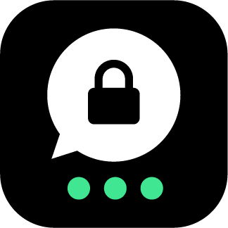
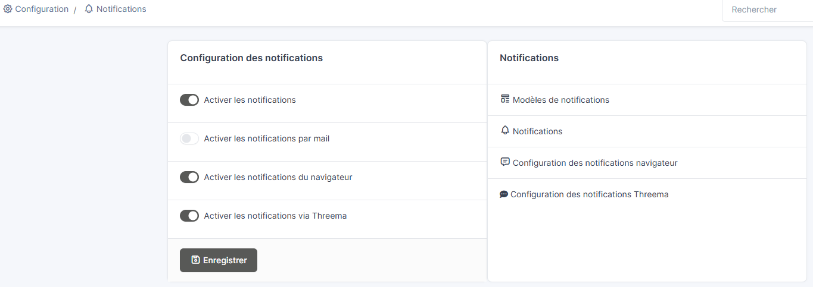
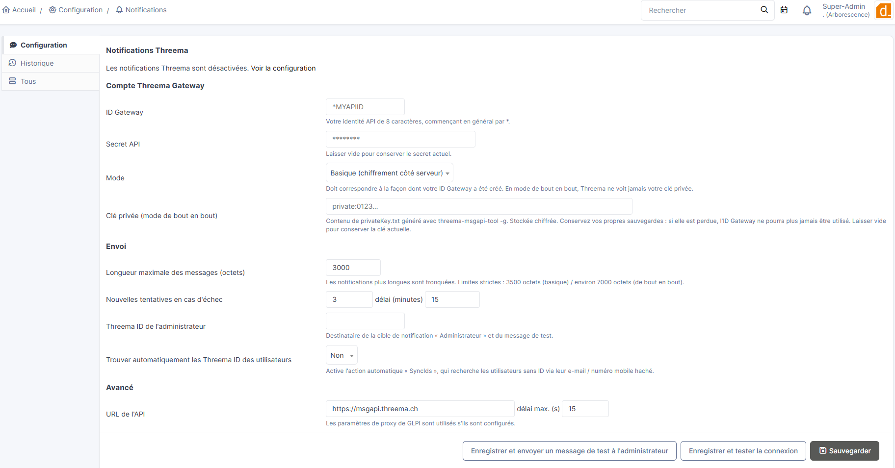
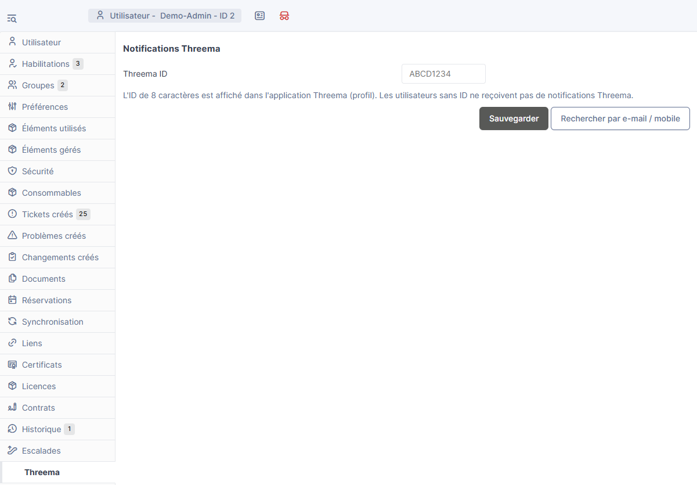
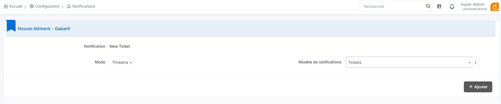

<p align="center">
  
</p>

<h1 align="center">Notifications Threema pour GLPI</h1>

<p align="center">
  Envoyez vos notifications GLPI via <a href="https://threema.com/en">Threema</a>, chiffrées de bout en bout, grâce à Threema Gateway.
</p>

<p align="center">
  <a href="LICENSE"></a>
  
  
  
</p>

<p align="center"><a href="README.md">🇬🇧 English version</a></p>

---

## Qu'est-ce que Threema ?

[Threema](https://threema.com/en) est une messagerie sécurisée développée par Threema AG, société basée en Suisse, dont l'infrastructure serveur se trouve en Suisse.

- Messages, appels et fichiers **chiffrés de bout en bout**.
- **Aucun numéro de téléphone ni adresse e-mail requis** : les utilisateurs sont identifiés par un **Threema ID** de 8 caractères.
- Applications open source, audits de sécurité externes réguliers et builds reproductibles.
- [**Threema Work**](https://threema.com/en/products/work) est l'édition pour les entreprises (console d'administration, groupes, appels).
- [**Threema Gateway**](https://threema.com/en/products/work/gateway) ([portail](https://gateway.threema.ch/)) permet à un logiciel d'envoyer des messages Threema via une API HTTP. C'est ce que ce plugin utilise.

Pour un service informatique, cela donne des alertes de tickets qui arrivent sur un canal déjà lu par les équipes, sans mettre le contenu des tickets en clair dans des e-mails.

## Fonctionnalités

- Ajoute **Threema** comme mode de notification, à côté de l'e-mail et du navigateur : à ajouter à n'importe quelle notification GLPI existante (nouveau ticket, attribution, alertes SLA, changements...).
- Deux modes Threema Gateway :
  - **De bout en bout** (recommandé) : le chiffrement est fait dans GLPI, Threema ne voit ni votre clé privée ni le contenu.
  - **Basique** : chiffrement côté serveur par Threema.
- **Threema ID par utilisateur**, sur la fiche utilisateur et dans les préférences personnelles. Recherche automatique optionnelle par adresse e-mail ou numéro mobile (hachés).
- Envoi via la **file d'attente de notifications GLPI** (comme les e-mails), avec nouvelles tentatives en cas d'erreur temporaire.
- Page de configuration avec **test de connexion** (crédits restants, cohérence clé privée / clé publique) et **message de test**.
- Secret API et clé privée **chiffrés** avec la clé GLPI. Le message reprend le sujet du modèle en gras, puis la version texte du modèle.
- Interface en français et en anglais.

## Captures d'écran

| | |
|:--:|:--:|
|  |  |
| *Activer le mode Threema dans la configuration des notifications* | *Page de configuration du plugin* |
|  |  |
| *Threema ID sur la fiche utilisateur* | *Ajouter le mode Threema à une notification* |

## Prérequis

- GLPI **11.x** / **12.x**
- PHP **8.2+** avec les extensions `curl` et `mbstring`, et `sodium` pour le mode de bout en bout
- Un compte [Threema Gateway](https://gateway.threema.ch/) avec des crédits
- Le cron de GLPI actif (les messages sont envoyés par l'action automatique `queuednotification`)

> Les versions de GLPI prises en charge sont définies par `PLUGIN_THREEMA_MIN_GLPI` / `PLUGIN_THREEMA_MAX_GLPI` dans `setup.php` (actuellement `>= 11.0.0` et `< 13.0.0`).

## Installation

1. Télécharger la dernière version sur la [page des releases](https://github.com/d-factos-SA/Threema/releases) et l'extraire dans le dossier `plugins/` (ou `marketplace/`) de GLPI. Le dossier **doit** s'appeler `threema`.
2. Dans **Configuration > Plugins**, installer puis activer **Threema**.
3. Dans **Configuration > Notifications > Configuration des notifications**, activer les notifications puis **Activer les notifications via Threema**, et ouvrir **Configuration des notifications Threema**.

## Côté Threema Gateway (une seule fois)

Pour le **mode de bout en bout** :

1. Générer la paire de clés avec l'outil officiel (`threema-msgapi-tool`, fourni avec le SDK sur le portail Gateway) :
   `./threema-msgapi-tool -g privateKey.txt publicKey.txt`
   **Sauvegardez `privateKey.txt` en plusieurs exemplaires** : si elle est perdue, l'ID Gateway est inutilisable à jamais.
2. Sur le portail Gateway : **Manage IDs > Request Threema ID**, mode **End-to-End**, ID souhaité (8 caractères, commence par `*`), puis coller la clé publique. Attendre la validation manuelle (plusieurs jours possibles) ; vous recevez alors le **secret API**.
3. Acheter des crédits (**Balance**).

Pour le **mode basique**, un ID Gateway « basic » et son secret suffisent.

## Configuration

**Configuration > Notifications > Configuration des notifications Threema** :

| Champ | Rôle |
|---|---|
| ID Gateway / Secret API | Identifiants du compte (le secret est chiffré avec la clé GLPI) |
| Mode | Doit correspondre au type de l'ID Gateway |
| Clé privée | Contenu de `privateKey.txt` (mode de bout en bout), stockée chiffrée. La clé publique correspondante est affichée pour contrôle |
| Longueur maximale | Les notifications plus longues sont tronquées (3500 octets en basique / environ 7000 en bout en bout) |
| Nouvelles tentatives / délai | En cas d'erreur temporaire (réseau, limite de débit, erreur serveur, plus de crédits) |
| Threema ID de l'administrateur | Destinataire de la cible « Administrateur » et du message de test |
| Trouver automatiquement les IDs | Active l'action automatique `SyncIds` (voir ci-dessous) |

**Enregistrer et tester la connexion** vérifie l'ID et le secret (et affiche les crédits restants) et, en bout en bout, que la clé privée correspond à la clé publique enregistrée chez Threema pour cet ID Gateway. **Enregistrer et envoyer un message de test** envoie un message à l'ID de l'administrateur.

## Utilisation

1. Chaque utilisateur (ou un administrateur) renseigne son **Threema ID** dans l'onglet **Threema** de la fiche utilisateur, ou dans ses propres **Préférences**. L'ID est affiché dans le profil de l'application Threema. Un bouton permet aussi de le retrouver par adresse e-mail / numéro mobile (seuls des hachés HMAC-SHA256 sont envoyés à Threema ; un mobile doit être au format international, par exemple `+41...`).
2. Dans **Configuration > Notifications > Notifications**, ouvrir une notification (par exemple « New Ticket »), puis dans l'onglet **Modèles** ajouter le mode **Threema** avec un modèle. Les destinataires sont ceux définis par la notification ; ceux sans Threema ID sont ignorés silencieusement.
3. Les messages passent par la file d'attente et sont envoyés par l'action automatique `queuednotification`, comme les e-mails.

Prévoyez des modèles courts pour Threema : l'URL de l'élément (`##ticket.url##`) suffit pour retourner dans GLPI.

### Action automatique `SyncIds` (optionnelle)

Désactivée par défaut. Si « Trouver automatiquement les IDs » est activé et l'action activée, elle recherche chaque jour, 50 utilisateurs par exécution, le Threema ID des utilisateurs actifs qui n'en ont pas, par adresse e-mail puis par mobile. Les utilisateurs introuvables sont ré-essayés après 30 jours.

### Journaux

`files/_log/threema.log` (envois réussis, mise en file) et `files/_log/threema-error.log` (échecs, abandons). Les erreurs permanentes (ID invalide ou inconnu, message trop long) ne sont pas ré-essayées ; les autres le sont selon la configuration.

## Désinstallation

Supprime les tables du plugin (`glpi_plugin_threema_userids`, `glpi_plugin_threema_pubkeys`), sa configuration, les liens « mode Threema » des notifications et les messages Threema en attente.

## Sécurité

- Le secret API et la clé privée sont chiffrés avec la clé GLPI (`glpicrypt.key`) : **sauvegardez aussi ce fichier**.
- En mode de bout en bout, GLPI a besoin de la clé privée pour envoyer : quiconque contrôle le serveur GLPI peut envoyer au nom de l'ID Gateway.
- Les clés publiques des destinataires sont mises en cache 30 jours (recommandation de Threema).
- Une notification contient ce que contient son modèle : évitez d'y mettre des données sensibles inutiles.

## Développement et tests

Sans base de données ni GLPI complet :

```
php tests/gateway_client_test.php
GLPI_SRC=/chemin/glpi-11-ou-12 php tests/glpi_harness_test.php
```

Le premier exécute le client Threema contre un faux gateway local (vrai chemin curl, messages de bout en bout déchiffrés côté faux gateway). Le second charge les classes du plugin contre les vraies interfaces de notification de GLPI et exerce la livraison de la file et les nouvelles tentatives.

## Limites

- Texte uniquement (pas d'images, fichiers, boutons ni groupes).
- Le plugin appelle directement l'API HTTP documentée de Threema Gateway et n'utilise pas le SDK PHP officiel. Faites le test de connexion et le message de test avant de vous y fier.

## Licence et marque

GPL v3 ou ultérieure, voir [LICENSE](LICENSE). © d-factos SA.

Threema est une marque de Threema AG. Ce plugin est un projet indépendant, non affilié à Threema AG, ni approuvé ou parrainé par elle.
