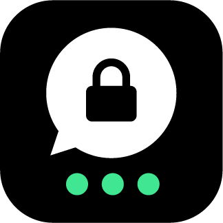
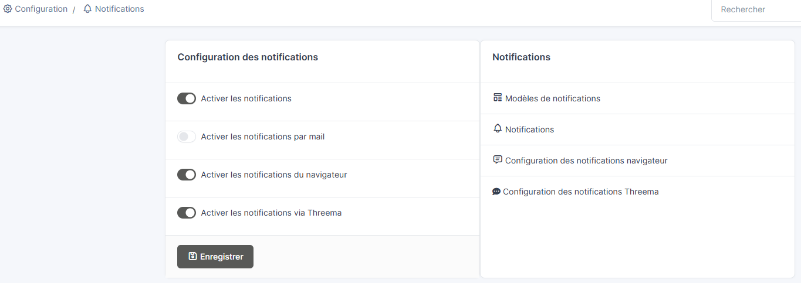
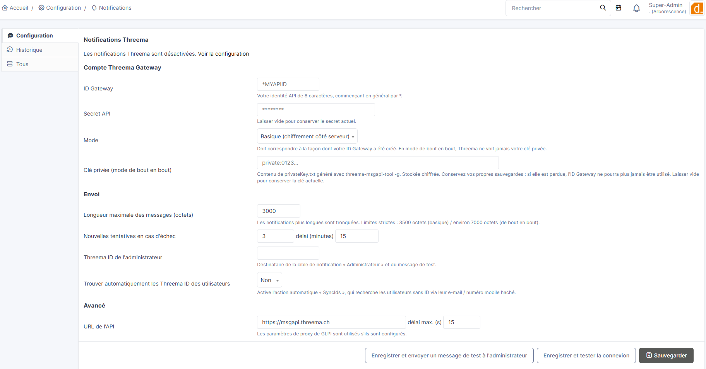
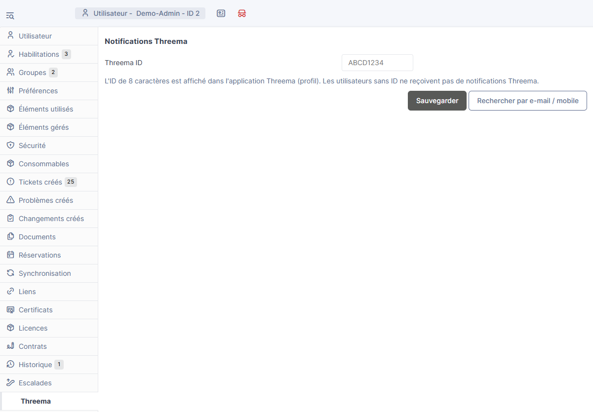
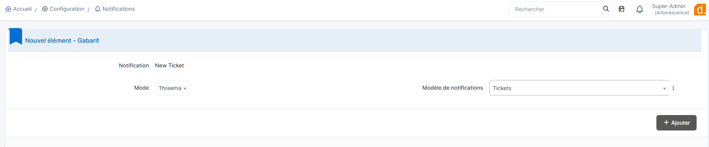

<p align="center">
  
</p>

<h1 align="center">Threema notifications for GLPI</h1>

<p align="center">
  Send your GLPI notifications through <a href="https://threema.com/en">Threema</a>, end-to-end encrypted, via Threema Gateway.
</p>

<p align="center">
  <a href="LICENSE"></a>
  
  
  
</p>

<p align="center"><a href="README.fr.md">🇫🇷 Version française</a></p>

---

## What is Threema?

[Threema](https://threema.com/en) is a secure messenger developed by Threema AG, a company based in Switzerland, with its server infrastructure in Switzerland.

- **End-to-end encrypted** messages, calls and files.
- **No phone number or e-mail address required**: users are identified by an 8-character **Threema ID**.
- Open-source apps, regular external security audits and reproducible builds.
- [**Threema Work**](https://threema.com/en/products/work) is the business edition (admin console, groups, calls).
- [**Threema Gateway**](https://threema.com/en/products/work/gateway) ([portal](https://gateway.threema.ch/)) lets software send Threema messages through an HTTP API. This is what this plugin uses.

For a service desk this means ticket alerts that reach people on a channel they already read, without putting ticket content in clear text e-mail.

## Features

- Adds **Threema** as a notification mode, next to e-mail and browser notifications: add it to any existing GLPI notification (new ticket, assignment, SLA alerts, changes...).
- Two Threema Gateway modes:
  - **End-to-end** (recommended): encryption happens in GLPI, Threema never sees your private key or the content.
  - **Basic**: server-side encryption by Threema.
- **Threema ID per user**, on the user form and in the personal preferences. Optional automatic lookup by (hashed) e-mail address or mobile number.
- Delivery through the **GLPI notification queue** (same as e-mails), with retries on temporary errors.
- Configuration page with **connection test** (remaining credits, private key / public key consistency) and a **test message**.
- API secret and private key **encrypted** with the GLPI key. Messages use the template subject in bold, then the text version of the template.
- English and French interface.

## Screenshots

| | |
|:--:|:--:|
|  |  |
| *Enable the Threema mode in the notification settings* | *Plugin configuration page* |
|  |  |
| *Threema ID on the user form* | *Add the Threema mode to a notification* |

## Requirements

- GLPI **11.x** / **12.x**
- PHP **8.2+** with the `curl` and `mbstring` extensions, and `sodium` for end-to-end mode
- A [Threema Gateway](https://gateway.threema.ch/) account with credits
- The GLPI cron running (messages are sent by the `queuednotification` automatic action)

> The plugin's supported GLPI range is set by `PLUGIN_THREEMA_MIN_GLPI` / `PLUGIN_THREEMA_MAX_GLPI` in `setup.php` (currently `>= 11.0.0` and `< 13.0.0`).

## Installation

1. Download the latest release from the [releases page](https://github.com/d-factos-SA/Threema/releases) and extract it into GLPI's `plugins/` (or `marketplace/`) directory. The folder **must** be named `threema`.
2. In **Setup > Plugins**, install then enable **Threema**.
3. In **Setup > Notifications > Notifications configuration**, enable notifications and **Enable notifications via Threema**, then open **Threema notifications configuration**.

## Threema Gateway setup (once)

For **end-to-end mode**:

1. Generate a key pair with the official tool (`threema-msgapi-tool`, from the SDK on the Gateway portal):
   `./threema-msgapi-tool -g privateKey.txt publicKey.txt`
   **Keep several backups of `privateKey.txt`**: if it is lost, the Gateway ID can never be used again.
2. On the Gateway portal: **Manage IDs > Request Threema ID**, choose **End-to-End** mode, enter the wanted ID (8 characters, starts with `*`) and paste the public key. Wait for the manual review (it can take several days); you then receive the **API secret**.
3. Buy credits (**Balance**).

For **basic mode**, a "basic" Gateway ID and its secret are enough.

## Configuration

**Setup > Notifications > Threema notifications configuration**:

| Field | Purpose |
|---|---|
| Gateway ID / API secret | Your account credentials (the secret is encrypted with the GLPI key) |
| Mode | Must match the type of your Gateway ID |
| Private key | Content of `privateKey.txt` (end-to-end mode), stored encrypted. The matching public key is displayed for checking |
| Maximum message length | Longer notifications are truncated (3500 bytes basic / about 7000 bytes end-to-end) |
| Retries / delay | On temporary errors (network, rate limit, server error, no credits) |
| Administrator Threema ID | Recipient of the "Administrator" notification target and of the test message |
| Find users' IDs automatically | Enables the `SyncIds` automatic action (see below) |

**Save and test connection** checks the ID and secret (and shows the remaining credits) and, in end-to-end mode, that your private key matches the public key registered at Threema for this Gateway ID. **Save and send a test message** sends a message to the administrator ID.

## Usage

1. Each user (or an administrator) enters the **Threema ID** in the **Threema** tab of the user form, or in their own **Preferences**. The ID is shown in the Threema app profile. A button can also look it up by e-mail address / mobile number (only HMAC-SHA256 hashes are sent to Threema; a mobile number must be international, e.g. `+41...`).
2. In **Setup > Notifications > Notifications**, open a notification (e.g. "New Ticket"), then in the **Templates** tab add the **Threema** mode with a template. Recipients are those defined by the notification; users without a Threema ID are silently skipped.
3. Messages are queued and sent by the `queuednotification` automatic action, like e-mails.

Keep Threema templates short: the item URL (`##ticket.url##`) is enough to get back to GLPI.

### Automatic action `SyncIds` (optional)

Disabled by default. When "Find users' IDs automatically" is on and the action is enabled, it looks up, every day and 50 users per run, active users that have no Threema ID, by e-mail address then mobile number. Users not found are retried after 30 days.

### Logs

`files/_log/threema.log` (sent messages, queueing) and `files/_log/threema-error.log` (failures, giving up). Permanent errors (invalid or unknown ID, message too long) are not retried; others are retried as configured.

## Uninstall

Removes the plugin tables (`glpi_plugin_threema_userids`, `glpi_plugin_threema_pubkeys`), its configuration, the "Threema" mode links of notifications and pending Threema messages.

## Security notes

- The API secret and private key are encrypted with the GLPI key (`glpicrypt.key`): **back this file up too**.
- In end-to-end mode GLPI needs the private key to send, so anyone controlling the GLPI server can send as the Gateway ID.
- Recipients' public keys are cached for 30 days (Threema's recommendation).
- A notification contains what its template contains: avoid unnecessary sensitive data.

## Development and tests

No database or full GLPI needed:

```
php tests/gateway_client_test.php
GLPI_SRC=/path/to/glpi-11-or-12 php tests/glpi_harness_test.php
```

The first runs the Threema client against a local fake gateway (real curl path, end-to-end messages decrypted on the fake gateway side). The second loads the plugin classes against the real GLPI notification interfaces and exercises queue delivery and retries.

## Limitations

- Text only (no images, files, buttons or groups).
- The plugin talks to the documented Threema Gateway HTTP API directly and does not use the official PHP SDK. Run the connection test and the test message before relying on it.

## License and trademark

GPL v3 or later, see [LICENSE](LICENSE). © d-factos SA.

Threema is a trademark of Threema AG. This plugin is an independent project and is not affiliated with, endorsed by or sponsored by Threema AG.
